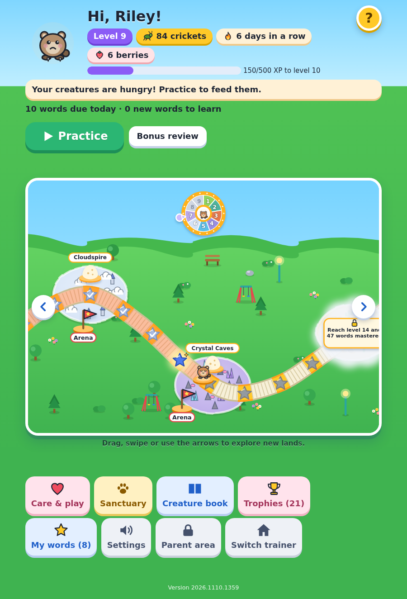
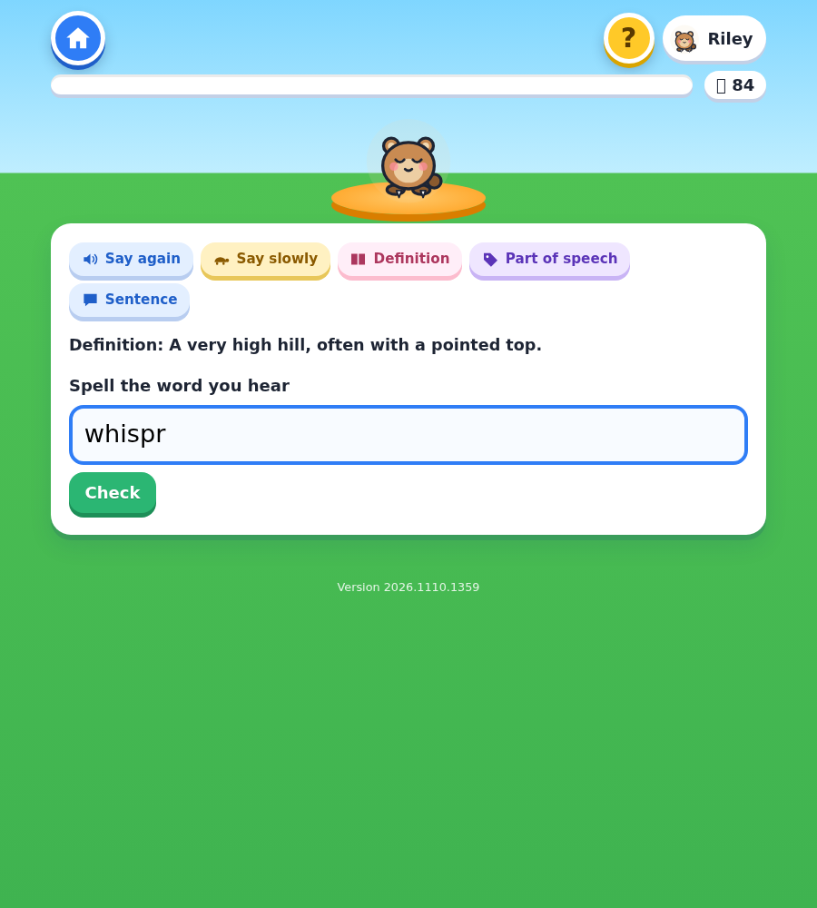
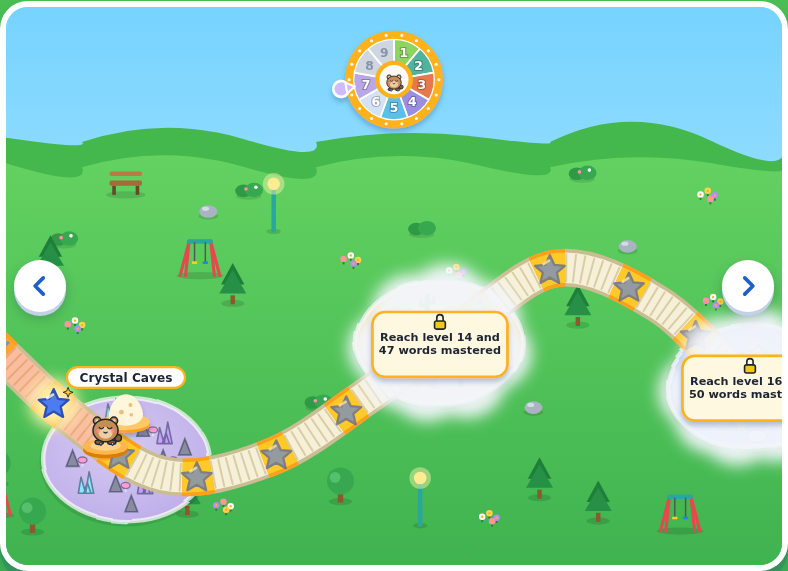
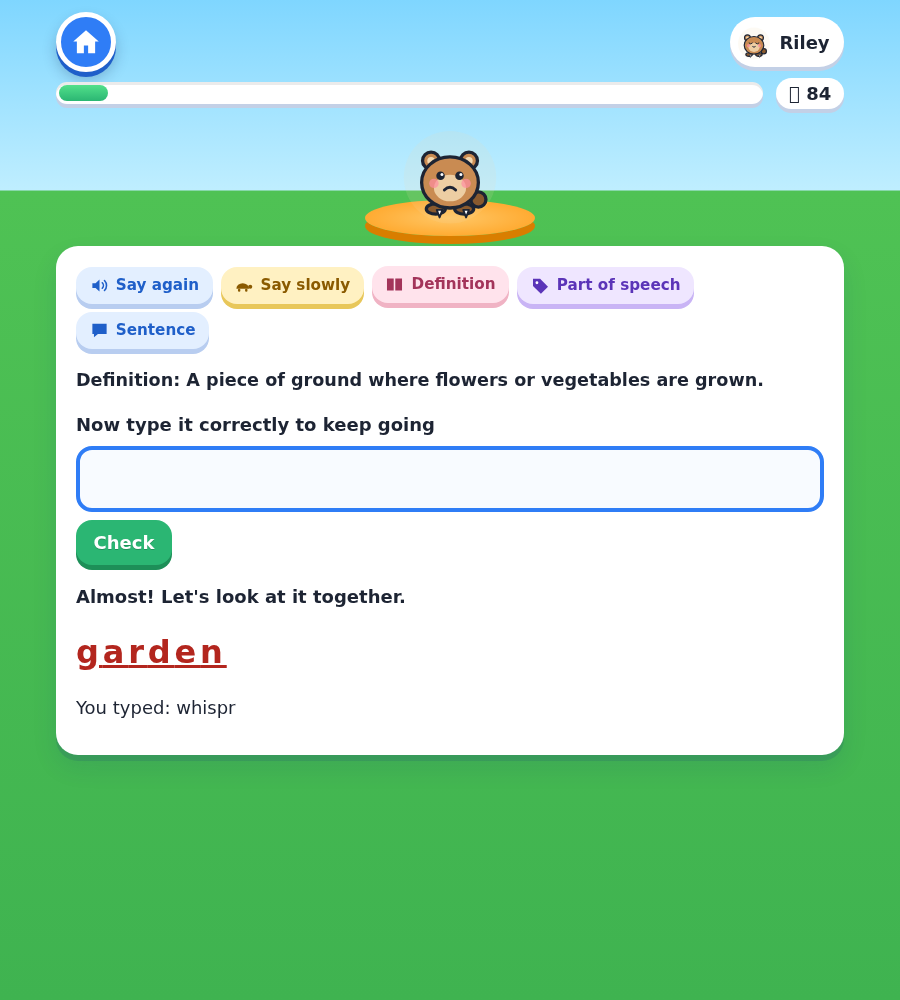
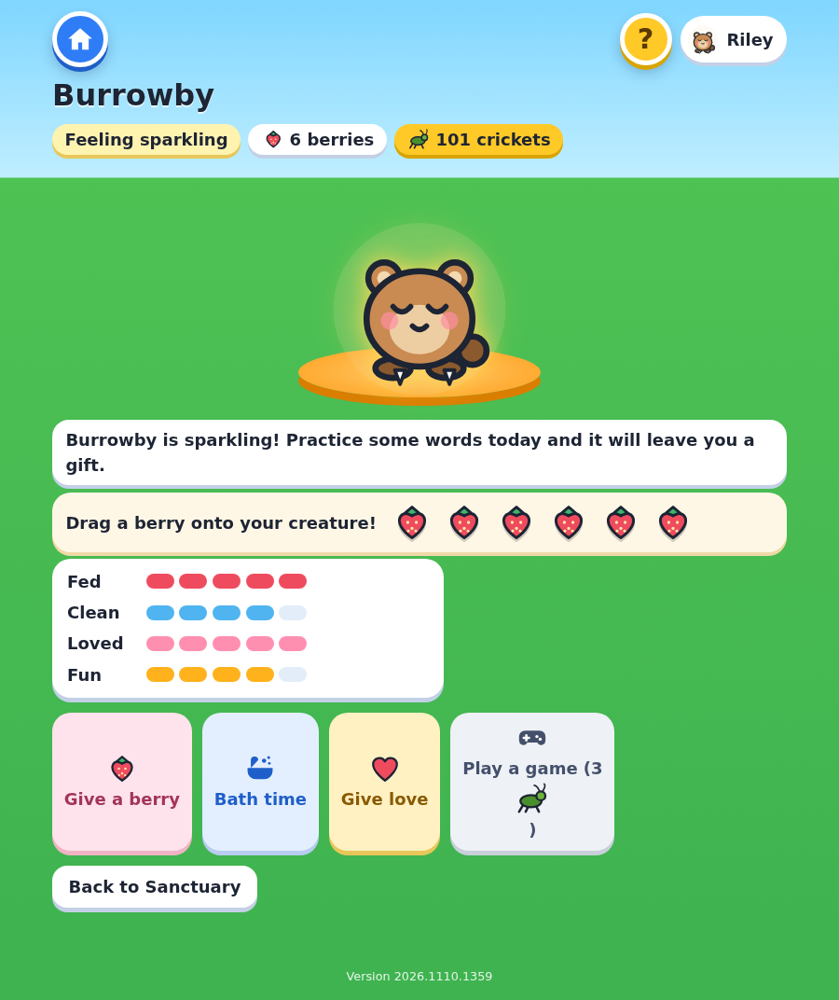
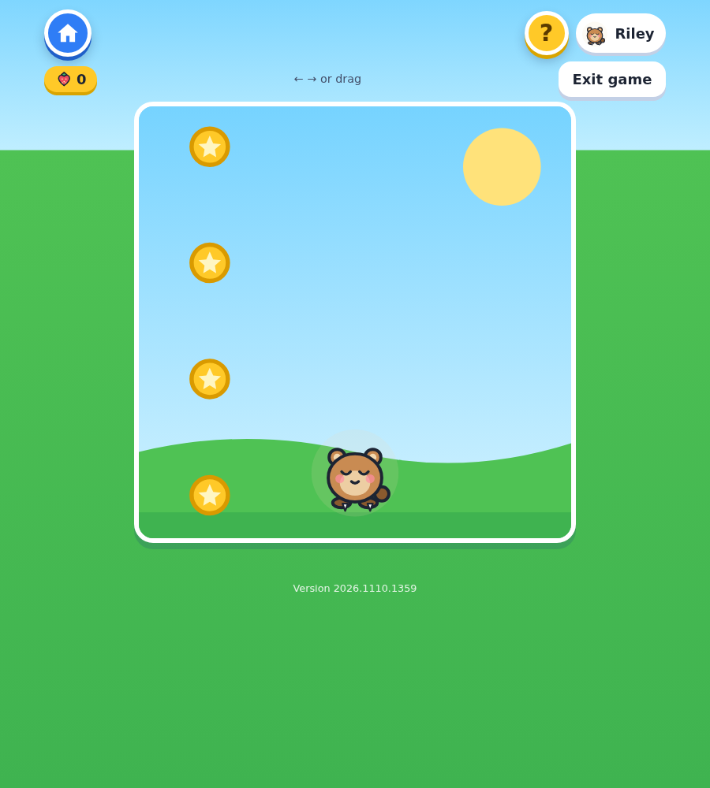
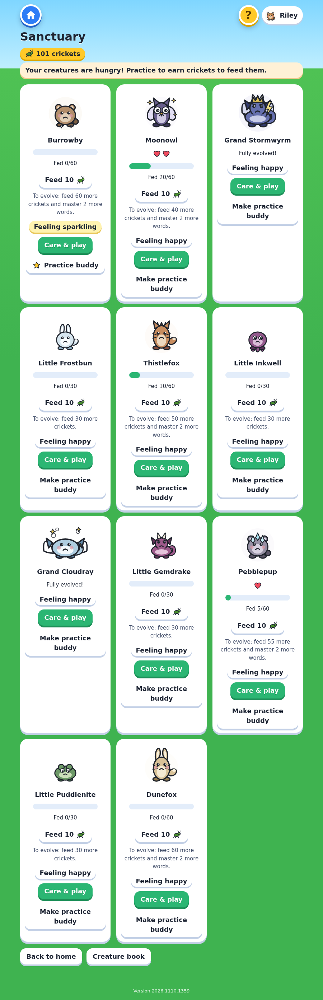
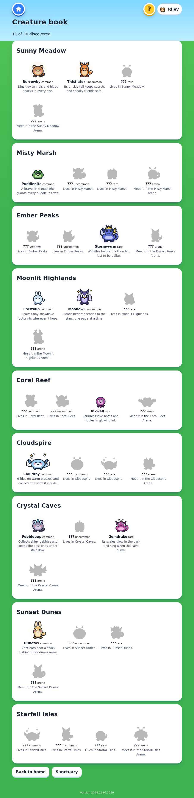

# Spellbeasts

**Play it: https://matt-moses.github.io/spellbeasts/**

A spelling-bee practice game with collectible creatures. The game says a word out loud and you type it, just like a real bee. Right answers earn crickets, XP and trophies, which hatch, feed and evolve a collection of 27 original creatures as you walk a trail through nine lands. Missed words come back on a spaced-repetition schedule until they stick.

It is a static site (vanilla JS modules, no build step, no runtime dependencies). Everything, including your word list and progress, stays in your browser.

| Home and world map | Practice |
|---|---|
|  |  |
| **Explore new lands** (the map scrolls sideways) | **Gentle feedback on a miss** |
|  |  |
| **Care for your creatures** | **Play Berry Catch** |
|  |  |
| **Sanctuary** | **Creature book** |
|  |  |

## What's in it

- **Spelling practice:** the first word waits a moment ("Get ready…") so you can settle in, and the word is spoken and never shown first. Replay it, slow it down, or ask for the definition, part of speech or a sentence. Answers are checked strictly, **including capital letters**. There is no timer.
- **Spaced repetition:** a miss returns about 3 turns later, then about 7 turns after a correct retry (at most 4 times a session). Across days, words climb five review boxes (every session, 2, 4, 7 and 14 days). A word is *mastered* after being right on the first try on 3 different days.
- **Progress that gets steadily harder:** each level costs more XP than the last, every land needs a higher level *and* more mastered words, each land's stretch of trail is longer than the one before, and egg prices and hatching effort rise with the lands.
- **A world to walk:** nine lands on one winding trail. Each first-try answer is a step; star tiles hold treasure. Lands unlock by level and mastery, and the map scrolls sideways to new ones.
- **27 original creatures, 3 stages each:** drawn in inline SVG. Buy eggs in each land's nest, warm them with correct answers, feed and evolve creatures (evolving ties to level and mastery).
- **Care and play:** feed berries, give a bath, pet, and play Berry Catch. Creatures stay happy day to day, and a sparkling creature leaves a small gift. Tap any character for a random animation, sound, effect or speech bubble.
- **Trophies:** 44 to earn, from first hatch to word master.
- **Parent area** (behind a grown-up check: choose the year you were born, which is never saved): load your own word lists and **give each trainer their own** (so a younger player can have an easier list, with separate progress), set how any word should be pronounced (for example "laffter"), see per-word stats and the most-missed words, manage trainers, and back up or restore everything as JSON.
- **Works offline, and installs like an app:** after one visit the whole game is cached by a service worker, so it runs with no connection. In Chrome or Edge choose *Install* (or on a phone, *Add to Home screen*). A small "new version" bar appears when an update is available.
- **Help for kids:** a round **?** button on every screen opens a pop-up of plain-language FAQs (how to play, crickets, creatures, the map, what to do if there is no sound). Opening it never interrupts a practice session.
- **Accessible by design:** large text, full keyboard use, visible focus, reduced-motion support, encouraging wording, and spellcheck/autocorrect off on the answer box.

## Using your own word list

Open **Parent area → Word lists** and paste one word per line: `word | part of speech | definition | sentence (optional)` (tabs or commas also work). The preview shows any problem lines before you import. The list is saved only in this browser's `localStorage` and is never uploaded.

**Copyright rule:** the repository ships only a small sample list written for this project. Real study lists (such as the Scripps Two Bee words) must never be committed. Local word files (`*.words.*`, `private/`) are git-ignored, and `npm run hygiene` scans for franchise names and for any words you list in `tools/denylist.local.txt` (git-ignored).

## Privacy

Everything you do stays in your browser. The live site counts visits with [Cloudflare Web Analytics](https://www.cloudflare.com/web-analytics/): it is cookieless and anonymous, recording only page views, referrer, country and device type. It has no custom events, so it never sees words, answers, scores or names. It loads only on the live site (never locally or in tests), is skipped when your browser sends Do Not Track, and offline launches are simply not counted.

## Development

```sh
npm install              # dev tooling only: playwright-core for the browser tests
bash tools/serve.sh      # serve the site at http://localhost:8000
npm run check            # hygiene scan + all unit and end-to-end tests
npm run screenshots      # regenerate the images above
npm run icons            # regenerate the app icons
```

- Game rules live in pure modules under `js/logic/` and are unit-tested with `node --test`, with no browser.
- The end-to-end tests drive real Chromium (`CHROMIUM_PATH` overrides the location). One of them plays about two weeks of simulated days through the real UI and checks every reward, box, due date, unlock, trophy and streak against an **independent model of the rules**, failing on any console error.
- **CI** runs the same checks on every push and pull request (`.github/workflows/ci.yml`).
- **Deploy:** GitHub Pages, deploy from branch `main` / root. There is no build step, so every push to `main` updates the live site.

```
index.html  css/  js/ui/ (screens)  js/logic/ (rules, pure)  js/platform/ (storage, speech, audio)
js/assets/ (creature art)  data/ (sample words)  test/  tools/  docs/
```

See [`docs/`](docs/) for the original PRD, the execution plan, and a note on what has grown beyond them.
